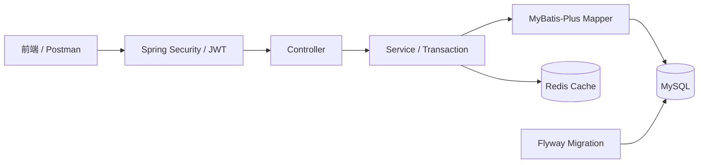

# inventory-order-system

基于 Spring Boot 3 的库存与订单管理后端练习项目，覆盖商品库存、用户认证、订单事务、Redis 缓存、数据库迁移、自动化测试和 Docker Compose 运行。

## 核心能力

- 商品增删改查、逻辑删除、恢复、上下架、筛选、分页和库存概览。
- 原子增加与扣减库存，并记录入库、出库流水。
- 用户注册、BCrypt 密码加密、JWT 登录认证和角色权限控制。
- 创建订单、分页查询本人订单、原子取消订单并退回库存。
- 使用事务保证订单、库存和库存流水的一致性。
- 使用带条件的原子 `UPDATE` 和 MySQL 行锁防止并发超卖。
- 使用 Redis 缓存商品查询，并为不存在商品设置短期标记缓解缓存穿透。
- 使用 Flyway 管理数据库结构版本和订单索引。
- 提供统一响应、参数校验、业务异常处理、Swagger 和健康检查。
- 提供 Mockito 单元测试、MockMvc Controller 测试、并发与事务回滚集成测试。

## 系统结构



请求先经过 JWT 认证和权限检查，再由 Controller 接收参数、Service 执行业务与事务、Mapper 访问 MySQL；商品查询缓存由 Redis 提供，数据库结构由 Flyway 迁移。

## 关键业务流程

创建订单：

```text
JWT 取得当前用户
→ 校验商品 ID 和购买数量
→ 查询商品并记录下单时单价
→ 原子扣减库存并记录出库流水
→ 保存订单
→ 转换成 OrderVO 统一返回
```

取消订单：

```text
校验订单归属和状态
→ 原子把“已创建”改为“已取消”
→ 仅在影响行数为 1 时退回库存
→ 返回更新后的订单
```

## 技术栈

| 分类 | 技术 |
| --- | --- |
| 基础 | Java 17、Maven |
| Web | Spring Boot 3.2.5、Spring MVC、Jakarta Validation |
| 数据访问 | MyBatis-Plus 3.5.5、MySQL 8、Flyway 10.20.1 |
| 安全 | Spring Security、JJWT 0.13.0、BCrypt |
| 缓存 | Spring Cache、Redis |
| 测试 | JUnit 5、Mockito、MockMvc、真实 MySQL 集成测试 |
| 工程 | Docker、Docker Compose、Swagger / OpenAPI、Actuator、Git |

## 项目结构

```text
src/main/java/.../
├─ controller     HTTP 请求入口
├─ service        业务逻辑和事务
├─ mapper         MyBatis-Plus 与自定义 SQL
├─ entity         数据库实体
├─ dto            请求数据
├─ vo             响应数据
├─ security       JWT 生成、解析和认证过滤
├─ config         Security、Redis、MyBatis、OpenAPI 配置
└─ exception      业务异常和统一异常处理

src/main/resources/db/migration   Flyway 迁移脚本
src/test/java                    单元、Controller 和集成测试
frontend                         简单商品管理演示页面
scripts                          集成测试运行脚本
```

## 环境变量

| 变量 | 作用 | 默认值 |
| --- | --- | --- |
| `DB_PASSWORD` | MySQL 密码，必填 | 无 |
| `JWT_SECRET` | Base64 JWT 密钥，解码后至少 32 字节，必填 | 无 |
| `DB_URL` | JDBC 地址 | 本机 `localhost:3306/inventory` |
| `DB_USERNAME` | MySQL 用户名 | `root` |
| `REDIS_HOST` | Redis 主机 | `127.0.0.1` |
| `REDIS_PORT` | Redis 端口 | `6379` |
| `SERVER_PORT` | 应用端口 | `8080` |
| `JWT_EXPIRATION_MS` | JWT 有效期（毫秒） | `86400000` |

复制环境变量模板：

```powershell
Copy-Item .env.example .env
```

编辑 `.env` 并填写真实值。不要提交 `.env`、数据库密码、完整 JWT 或密钥。

## Docker Compose 运行

先启动 Docker Desktop，然后执行：

```powershell
mvn package
docker compose up -d --build
docker compose ps
```

Flyway 会在应用启动时自动创建或迁移数据库，不需要手动执行建表脚本。

默认端口映射：

| 服务 | Windows 端口 | 容器端口 |
| --- | ---: | ---: |
| Spring Boot | 8080 | 8080 |
| MySQL | 3307 | 3306 |
| Redis | 6380 | 6379 |

查看应用日志：

```powershell
docker compose logs app --tail 100
```

停止服务但保留数据卷：

```powershell
docker compose down
```

不要随意执行 `docker compose down -v`，它会删除 MySQL 和 Redis 数据卷。

## 测试

运行普通测试：

```powershell
mvn test
```

运行真实 MySQL 并发与事务回滚集成测试：

```powershell
.\scripts\run-integration-tests.ps1
```

集成测试脚本会读取 `.env` 中的 `DB_PASSWORD`，启动 Docker MySQL，然后执行：

- `ProductConcurrencyIT`：库存为 1 时两个线程同时扣减，只有一个成功。
- `OrderTransactionRollbackIT`：订单保存失败后，库存和库存流水一起回滚。

## 接口与健康检查

应用启动后访问：

- Swagger UI：<http://localhost:8080/swagger-ui.html>
- OpenAPI JSON：<http://localhost:8080/v3/api-docs>
- 健康检查：<http://localhost:8080/actuator/health>

主要接口前缀：

- 认证：`/api/auth`
- 商品与库存：`/api/products`
- 订单：`/api/orders`
- 管理员：`/api/admin`

## 当前边界

- 当前是个人学习项目，不宣称生产级高可用或完整分布式架构。
- JWT 中的角色在 Token 过期前不会自动感知数据库角色变化；Redis Token 版本属于后续扩展，尚未实现。
- 前端为简单联调页面，项目重点仍是 Java 后端、数据库一致性和工程验证。
