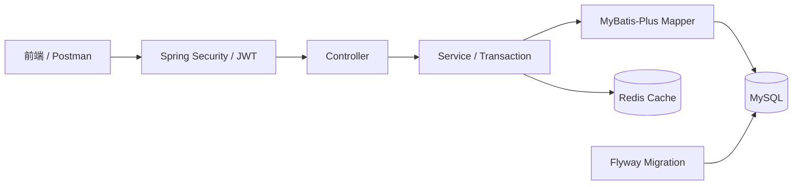

# inventory-order-system

基于 Spring Boot 3 的库存与订单管理后端练习项目，覆盖商品库存、用户认证、订单事务、Redis 缓存、数据库迁移、自动化测试和 Docker Compose 运行。

## 核心能力

当前版本定位为已收尾的本地学习演示版，不是生产发布版。2026-10-20 最终 `mvn package` 成功，39 个普通测试通过；独立集成测试脚本由用户运行，3 个测试通过。已有实现及已知限制见下文，后续学习不作为本版本的完结前提。

- 商品增删改查、逻辑删除、恢复、上下架、筛选、分页和库存概览。

- 原子增加与扣减库存，并记录入库、出库流水。

- 用户注册、BCrypt 密码加密、JWT 登录认证和角色权限控制；禁用用户时增加 Token 版本，认证过滤器检查数据库中的用户状态与版本。

- 创建订单、分页查询本人订单、原子取消订单并退回库存。

- 使用事务保证订单、库存和库存流水的一致性。

- 使用带条件的原子 `UPDATE` 和 MySQL 行锁防止并发超卖。

- 使用 Redis 手动缓存商品查询，并为不存在商品设置短期标记缓解缓存穿透。

- 使用 Redis 互斥锁（`setIfAbsent`）与缓存双重检查，减少热点商品缓存未命中时的并发查库；不保证任意场景都仅查库一次。

- 使用 Flyway 管理数据库结构版本和订单索引。

- 提供统一响应、参数校验、业务异常处理、Swagger 和健康检查。

- 提供 Mockito 单元测试、MockMvc Controller 测试、并发与事务回滚集成测试。

## 系统结构



请求先经过 JWT 认证和权限检查，再由 Controller 接收参数、Service 执行业务与事务、Mapper 访问 MySQL；商品查询缓存由 Redis 提供，数据库结构由 Flyway 迁移。

## 关键业务流程

创建订单：

```text
JWT 取得当前用户
→ 校验商品 ID 和购买数量
→ 查询商品并记录下单时单价
→ 原子扣减库存并记录出库流水
→ 保存订单
→ 转换成 OrderVO 统一返回
```

取消订单：

```text
校验订单归属和状态
→ 原子把“已创建”改为“已取消”
→ 仅在影响行数为 1 时退回库存
→ 返回更新后的订单
```

## 技术栈

| 分类   | 技术                                                     |
| ---- | ------------------------------------------------------ |
| 基础   | Java 17、Maven                                          |
| Web  | Spring Boot 3.2.5、Spring MVC、Jakarta Validation        |
| 数据访问 | MyBatis-Plus 3.5.5、MySQL 8、Flyway 10.20.1              |
| 安全   | Spring Security、JJWT 0.13.0、BCrypt                     |
| 缓存   | Redis（`StringRedisTemplate` 手动缓存 + `setIfAbsent` 分布式锁） |
| 测试   | JUnit 5、Mockito、MockMvc、真实 MySQL 集成测试                  |
| 工程   | Docker、Docker Compose、Swagger / OpenAPI、Actuator、Git   |

## 项目结构

```text
src/main/java/.../
├─ controller     HTTP 请求入口
├─ service        业务逻辑和事务
├─ mapper         MyBatis-Plus 与自定义 SQL
├─ entity         数据库实体
├─ dto            请求数据
├─ vo             响应数据
├─ security       JWT 生成、解析和认证过滤
├─ config         Security、Redis、MyBatis、OpenAPI 配置
└─ exception      业务异常和统一异常处理

src/main/resources/db/migration   Flyway 迁移脚本
src/test/java                    单元、Controller 和集成测试
frontend                         简单商品管理演示页面
scripts                          集成测试运行脚本
```

## 环境变量

| 变量                  | 作用                           | 默认值                           |
| ------------------- | ---------------------------- | ----------------------------- |
| `DB_PASSWORD`       | MySQL 密码，必填                  | 无                             |
| `JWT_SECRET`        | Base64 JWT 密钥，解码后至少 32 字节，必填 | 无                             |
| `DB_URL`            | JDBC 地址                      | 本机 `localhost:3306/inventory` |
| `DB_USERNAME`       | MySQL 用户名                    | `root`                        |
| `REDIS_HOST`        | Redis 主机                     | `127.0.0.1`                   |
| `REDIS_PORT`        | Redis 端口                     | `6379`                        |
| `SERVER_PORT`       | 应用端口                         | `8080`                        |
| `JWT_EXPIRATION_MS` | JWT 有效期（毫秒）                  | `86400000`                    |

复制环境变量模板：

```powershell
if (-not (Test-Path .env)) { Copy-Item .env.example .env }
```

编辑 `.env` 并填写真实值。不要提交 `.env`、数据库密码、完整 JWT 或密钥。

不要覆盖已有 `.env`。修改其中的密码也不会自动修改已有 MySQL 数据卷中的账户密码。

## IDEA 本地启动：先确认连接的是哪一份数据库

本项目曾同时使用 Windows 本地 MySQL 和 Docker MySQL，两者都可以有名为 `inventory` 的数据库，但数据不相通。

| 运行方式 | 应用连接 MySQL | Navicat 连接 | Redis |
| --- | --- | --- | --- |
| IDEA，未覆盖默认地址 | `localhost:3306/inventory` | `localhost:3306` | 默认 `127.0.0.1:6379` |
| IDEA，使用 Docker 基础设施 | 显式设置 `DB_URL` 为 `localhost:3307/inventory` 的 JDBC 地址 | `localhost:3307` | 显式设置 `REDIS_HOST=localhost`、`REDIS_PORT=6380` |
| Docker Compose 内的应用 | Compose 设置 `mysql:3306/inventory` | `localhost:3307` | Compose 设置 `redis:6379` |

在 IDEA 的启动配置中设置 `DB_PASSWORD`、`JWT_SECRET`，以及所选环境需要覆盖的连接变量。普通 Spring Boot 启动不会自动读取项目根目录 `.env`；Compose 使用 `.env`，集成测试脚本则单独读取其中的数据库密码。

需要 Docker MySQL、Redis 时先启动 Docker Desktop，再执行：

```powershell
docker compose up -d --wait mysql redis
```

然后在 IDEA 运行 `InventoryPracticeApplication`。IDEA 应用和 Compose 的 `app` 不要同时占用 8080；切换运行方式前先停止原应用。

若“注册成功但 Navicat 查不到用户”，优先核对应用实际 JDBC 地址与 Navicat 端口，不要重复建用户或重置密码。

## Docker Compose 运行

先启动 Docker Desktop，然后执行：

```powershell
mvn package
docker compose up -d --build
docker compose ps
```

Flyway 会在应用启动时自动创建或迁移数据库，不需要手动执行建表脚本。

默认端口映射：

| 服务          | Windows 端口 | 容器端口 |
| ----------- | ---------: | ---: |
| Spring Boot |       8080 | 8080 |
| MySQL       |       3307 | 3306 |
| Redis       |       6380 | 6379 |

查看应用日志：

```powershell
docker compose logs app --tail 100
```

停止服务但保留数据卷：

```powershell
docker compose down
```

不要随意执行 `docker compose down -v`，它会删除 MySQL 和 Redis 数据卷。

## 测试

运行普通测试：

```powershell
mvn test
```

运行真实 MySQL 并发与事务回滚集成测试：

```powershell
.\scripts\run-integration-tests.ps1
```

集成测试脚本会读取 `.env` 中的 `DB_PASSWORD`，启动 Docker MySQL 和 Redis，并设置 `DB_URL` 指向 Windows 的 3307、Redis 指向 6380，然后执行：

- `ProductConcurrencyIT`：库存为 1 时两个线程同时扣减，只有一个成功。

- `OrderTransactionRollbackIT`：保存订单前确认库存 5 已扣至 3、出库流水 1 条，再模拟保存失败；事务结束后确认库存恢复 5、流水 0、订单 0。

- `ProductCacheConcurrencyIT`：验证指定并发场景下的缓存回填和查库次数。

集成测试会写入并清理临时测试数据，仅在本地开发/测试数据库执行，不要指向生产数据库。普通 `mvn test` / `mvn package` 不会按默认命名规则执行这些 `*IT` 测试，需要单独运行脚本。

### 已有验证证据（2026-10-20）

- 最终 `mvn package`：39 个普通测试通过，Failures / Errors 均为 0，生成 `target/inventory-practice-0.0.1-SNAPSHOT.jar`。

- 用户运行集成测试脚本：3 个测试通过，Failures / Errors 均为 0；缓存场景输出 10 个线程、查库 1 次，该结果不等于通用性能或压力测试结论。
- 本地应用连接 3306 时，普通用户原 Token 访问 `/api/auth/me` 返回 200，管理员 `POST /api/admin/users/{id}/disable` 返回 200，同一普通用户 Token 再次访问返回 401。
- 临时普通用户及管理员最终均已禁用；学习文档不保存账号密码与完整 Token。
- 3307 中查询确认 V5 迁移成功；不把另一实例的迁移记录当作 3306 的验证证据。

## 接口与健康检查

应用启动后访问：

- Swagger UI：<http://localhost:8080/swagger-ui.html>

- OpenAPI JSON：<http://localhost:8080/v3/api-docs>

- 健康检查：<http://localhost:8080/actuator/health>

主要接口前缀：

- 认证：`/api/auth`

- 商品与库存：`/api/products`

- 订单：`/api/orders`

- 管理员：`/api/admin`

## 当前边界

- 当前是个人学习项目，不宣称生产级高可用或完整分布式架构。

- JWT 中的角色不会自动感知数据库角色变化；更改角色后需要重新登录，或由管理逻辑主动使旧 Token 失效。当前每次认证查询 MySQL 的状态与 Token 版本，未使用 Redis 保存认证状态。

- 商品缓存已实现手动读写、不存在商品短期标记和互斥回填。未抢锁请求等待 50ms 后仍可能直接查库；锁使用固定值且直接删除，尚未实现持有者校验，锁过期后的慢请求可能误删后续请求的锁。不能宣称生产级分布式锁。

- 部分库存事务中会在提交前删除 Redis 缓存，尚未解决并发旧值回填和删缓存失败补偿；MySQL 事务不会自动回滚 Redis 操作，不保证数据库与缓存强一致。缓存雪崩未使用随机 TTL 专项处理。

- 未实现创建订单请求幂等键、订单数量编辑或订单版本乐观锁；相关内容仅作学习讨论，不作为已实现功能。

- 前端为简单联调页面，项目重点仍是 Java 后端、数据库一致性和工程验证。
